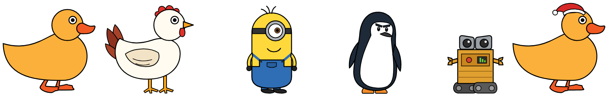

# Kachny (Ducks)


Tento projekt vznikl jen pro pobavení mé a mých kolegů v práci. Existuje ve verzi pro MS Windows Powershell a ve verzi pro Linux (testováno na Ubuntu).


This project was created just for my and my colleagues' amusement at work. It exists in a version for MS Windows Powershell and in a version for Linux (tested on Ubuntu).

## Co to dělá? (What is it doing?)

### MS Windows, Powershell


### Linux


## Jak použít? (How to use?)

### PowerShell v2 (doporučeno / recommended)

1. Stáhněte oba soubory do stejné složky (Download both files into the same folder):
   [powershell_kachna_v2.ps1](./powershell_kachna_v2.ps1?raw=true) a (and) [powershell_kachna_v2.cmd](./powershell_kachna_v2.cmd?raw=true)
2. Spusťte dvojklikem na `powershell_kachna_v2.cmd`. (Double-click `powershell_kachna_v2.cmd`.)
   Kachna se spustí bez okna konzole. (The duck starts without a console window.)
   Pokud Windows zobrazí „Systém Windows ochránil váš počítač“, zvolte „Další informace“ → „Přesto spustit“.
   (If Windows shows "Windows protected your PC", choose "More info" → "Run anyway".)
3. Nebo z PowerShellu (Or from PowerShell):
   ```powershell
   powershell -NoProfile -ExecutionPolicy Bypass -File .\powershell_kachna_v2.ps1
   ```

Ovládání (Controls):

| Akce (Action) | Co se stane (What happens) |
|---|---|
| Klepnutí levým tlačítkem na kachnu (Left click) | Pauza / pokračování. Zapauzovaná kachna si každou minutu postěžuje. (Pause / resume. A paused duck complains every minute.) |
| Dvojklik na kachnu (Double-click) | Poskok. (A hop.) |
| Přetažení levým tlačítkem (Left drag) | Přesun kachny kamkoli, i na jiný monitor. Po puštění spadne na spodní okraj obrazovky. (Move the duck anywhere, even to another monitor. When released, it falls to the bottom of the screen.) |
| Najetí myší na bublinu (Hover over the bubble) | Bublina se na chvíli schová, takže jde kliknout na okno pod ní. (The bubble hides for a moment so you can click the window below it.) |
| Pravé tlačítko na kachně (Right click) | Menu: Pauza, Skrýt kachnu, Skrýt na…, Postava, Střídat postavy, Nakrmit rohlíkem, Pojď za myší, Rychlost chůze, Rychlost hlášek, Úsporný režim, Připomínky, Nastavení, Ukončit. (Menu: Pause, Hide duck, Hide for…, Character, Rotate characters, Feed a bread roll, Follow the mouse, Walking speed, Phrase speed, Power saving, Reminders, Settings, Exit.) |
| Ikona vedle hodin (Tray icon) | Stejné menu + „Přivolat kachnu k myši“, dvojklik také přivolá kachnu. Tady se skrytá kachna zase zobrazí („Zobrazit kachnu“). Skrytá kachna stojí, mlčí a nezatěžuje počítač. (Same menu + "Summon duck to mouse", double-click summons it too. A hidden duck is shown again here ("Show duck"). While hidden, the duck stands still, stays quiet and uses no CPU.) |

V menu Nastavení (Settings menu): náhodné chování, chůze přes monitory, sezónní převleky, střídat postavy popořadě, zapnuté kachní hlášky, tichý režim (bez bublin), zvuk (kvák), vždy navrchu, pamatovat si nastavení, obnovit výchozí nastavení, vytvořit zástupce na ploše.
(Random behaviour, walking across monitors, seasonal costumes, rotate characters in order, duck phrases on, quiet mode (no bubbles), sound (quack), always on top, remember settings, restore default settings, create a desktop shortcut.)

Pamatovat si nastavení (Remember settings): volby z menu se ukládají do `%USERPROFILE%\Kachna\nastaveni.json` a platí i po dalším
spuštění; vypnutí soubor smaže. Při spuštění kachna vytvoří (pokud chybí) zástupce „Kachna“ ve složce `%USERPROFILE%\Kachna`
a v nabídce Start; připnout na Start ho jde pravým tlačítkem („Připnout na Start“). Zástupce spouští skript ze sdílené
složky `\\192.168.10.250\verejna$\Scripts\kachna2.ps1` (`ShortcutScript` v `$config`).
(Menu choices are saved to `%USERPROFILE%\Kachna\nastaveni.json` and restored on the next start; turning it off deletes the
file. On start the duck creates a "Kachna" shortcut (if missing) in `%USERPROFILE%\Kachna` and in the Start menu – pin it
with right click → "Pin to Start". The shortcut runs the script from the network share set in `ShortcutScript`.)

Postavy (Characters): kachna, slepice, žlutý brýlatý skřítek, tučňák velitel, který se při chůzi kolébá, a robot uklízeč R1, který mluví hlavně o sbírání a recyklaci odpadu. Každá postava má vlastní hlášky, hlas a převleky.
Po startu chodí kachna, v menu „Postava“ jde změnit a „Střídat postavy“ ji mění každých 15 minut (výchozí), hodinu
nebo 3 hodiny (náhodně, nebo popořadě). O Vánocích (1. 12. – 6. 1.) chodí kachna s mikulášskou čepicí. Výchozí postavu
a kalendář jde změnit na začátku skriptu v `$config` (`Character`, `CharacterCalendar`).
(Duck, hen, a yellow goggled sprite and a waddling penguin commander and R1, a cleaning robot who talks mostly about collecting and recycling waste, each with its own phrases, voice and costumes. The duck starts;
change the character in the "Character" menu; "Rotate characters" switches it randomly every 15 minutes by default (or every hour or 3 hours). At
Christmas the duck with a Santa hat is forced. Change the default and the calendar in `$config` at the top of the script.)



Novinky ve v2 (What's new in v2):

- více monitorů s různým rozlišením i škálováním, např. 1920×1080, 1920×1200, 2K, 4K; kachna umí přejít na sousední monitor (multiple monitors with different resolutions and scaling; the duck can walk over to the neighbouring monitor),
- kachna dojde až k okraji obrazovky a respektuje hlavní panel na libovolné straně (the duck walks all the way to the screen edge and respects the taskbar on any side),
- plynulý pohyb, bublina je vždy u hlavy, přizpůsobí se délce textu a po chvíli zmizí (smooth movement, the bubble stays at the head, fits the text and disappears after a while),
- hlášky se neopakují hned po sobě, kachna se občas sama zastaví, otočí nebo změní tempo (no phrase twice in a row, random stops, turns and pace changes),
- hlášky podle denní doby, svátků, stavu baterie a ušlé vzdálenosti (phrases depending on the time of day, holidays, battery and the distance walked),
- připomínky: pitný režim, protažení, Pomodoro – po startu zapnuté (reminders: drink water, stretch, Pomodoro – on by default),
- postavy: kachna, slepice, žlutý brýlatý skřítek, tučňák velitel, robot uklízeč – náhodně, z menu, střídání, podle kalendáře (characters: duck, hen, yellow goggled sprite, penguin commander, cleaning robot – random, from the menu, rotating, by calendar),
- krmení rohlíkem, „Pojď za myší“, poskok, sezónní převleky (čepice v prosinci, brýle v létě), volitelný zvuk (feeding, follow the mouse, hop, seasonal costumes, optional sound),
- šetří počítač: pohyb řídí animace WPF s omezeným počtem snímků, při zamčení PC se schová, po 10 minutách bez pohybu myši usne, na baterii přejde do úsporného režimu (saves resources: movement driven by frame-limited WPF animations, hides when the PC is locked, falls asleep after 10 minutes without mouse movement, power saving on battery),
- po změně rozlišení nebo odpojení monitoru kachna nezmizí mimo obrazovku (the duck stays visible after a resolution change or when a monitor is disconnected).

Funguje ve Windows PowerShell 5.1 i PowerShell 7. (Works in Windows PowerShell 5.1 and PowerShell 7.)
Pro ladění spusťte `powershell_kachna_v2.cmd ladeni` – chyby se vypíší do konzole. (For debugging run `powershell_kachna_v2.cmd ladeni` – errors are printed to the console.)
Kvákání: když vedle skriptu leží `kvak.wav`, přehraje se místo vygenerovaného zvuku. (Quack: a `kvak.wav` next to the script is played instead of the generated sound.)


### PowerShell v1 (původní verze / original version)

1. Stáhněte soubor (Download file) [powershell_kachna.ps1](./powershell_kachna.ps1?raw=true)
2. Spusťte v PowerShellu. (Run in PowerShell.)
   ```powershell
   powershell -NoProfile -ExecutionPolicy Bypass -File .\powershell_kachna.ps1
   ```
3. Kliknutím pravým tlačítkem myši na kachnu, ukončete program. (Right-click on the duck to exit the program.)


### Linux

1. Stáhněte soubor (Download file) [linux_kachna_v2_launch.sh](./linux_kachna_v2_launch.sh?raw=true)
2. Stáhněte soubor (Download file) [linux_kachna_v2_func.sh](./linux_kachna_v2_func.sh?raw=true)
3. Spusťte v terminálu. (Run in terminal.)
```bash
chmod +x linux_kachna_v2_launch.sh
./linux_kachna_v2_launch.sh
```
3. Pište slovo "konec" pro ukončení a stiskněte klávesu [ENTER]. (Type the word "konec" to end and press [ENTER])


## Testy (Tests)

Testy PowerShell verze v2 nepotřebují Windows, běží i v PowerShell 7 na Linuxu. Kontrolují kódování, XAML, rozměry kresby a převleků, hlášky a logiku kachny (chůze, pauza, přetažení, pád, chůze přes monitory, změna monitoru, skrytí, spánek, krmení, připomínky, menu, šetření procesorem) na simulovaných monitorech 1080p / 1200p / 2K / 4K.
(The v2 tests do not need Windows and also run in PowerShell 7 on Linux.)

```powershell
pwsh -NoProfile -File tests/Test-KachnaV2.ps1
```

Spotřebu běžící kachny (procesor a paměť) změří ve Windows (Measure the running duck's CPU and memory on Windows):

```powershell
powershell -NoProfile -ExecutionPolicy Bypass -File tests\Measure-KachnaV2.ps1 -IntervalSec 30 -Count 10
```


## Buy Me A Coffee
   
[](https://www.buymeacoffee.com/vlapri)

[!](https://www.buymeacoffee.com/vlapri)
